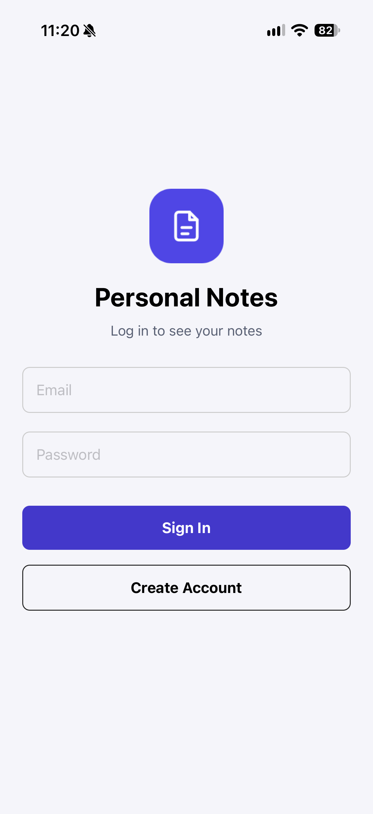
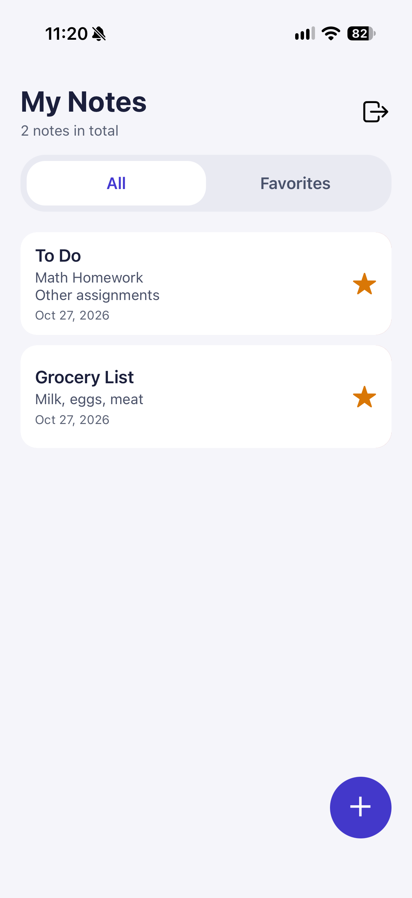
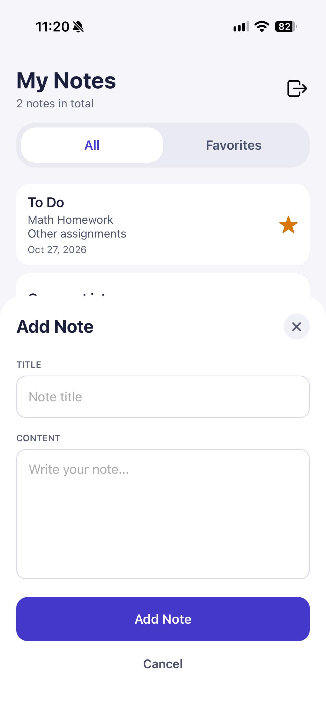
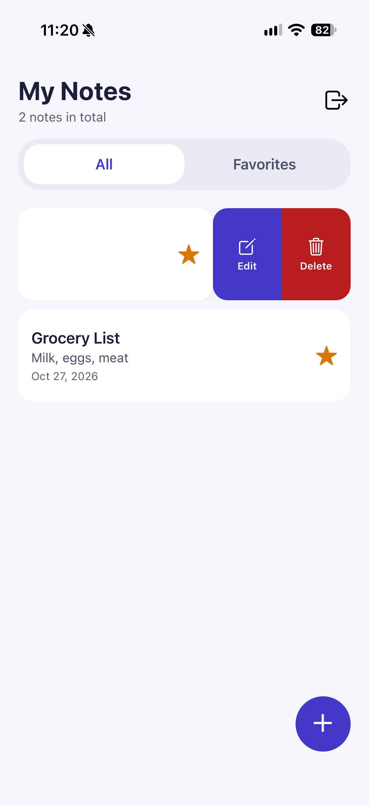

# Personal Notes App

This project is a React Native Expo application for creating and managing personal notes with secure, user-specific access.

## About the app

The Personal Notes App allows each authenticated user to create, view, edit, delete, and favorite their own notes. Notes are stored in Firebase Cloud Firestore and protected by Firebase Authentication so that users only see and manage their own records.

### Features

- Firebase Authentication for signup, login, and logout
- Cloud Firestore for storing note data
- User-specific note access and data security
- Note creation, editing, and deletion
- Favorites filtering and note summary counts
- Clean mobile-friendly UI using React Native and Expo

## Get started

1. Install dependencies

   ```bash
   npm install
   ```

2. Start the app

   ```bash
   npx expo start
   ```

## Screenshots

<table>
  <tr>
    <td></td>
    <td></td>
    <td></td>
    <td></td>
  </tr>
</table>
